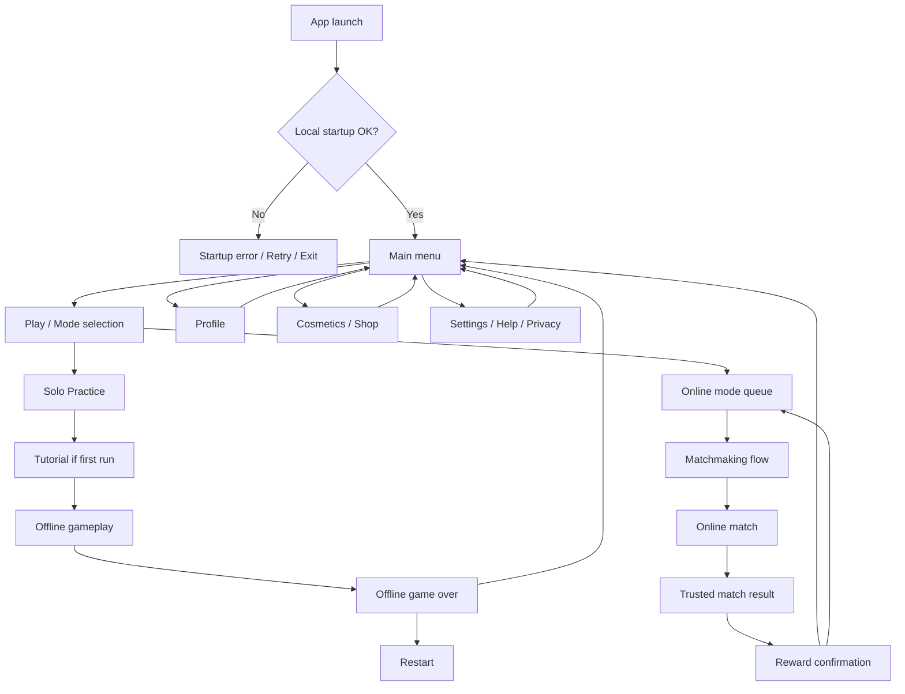
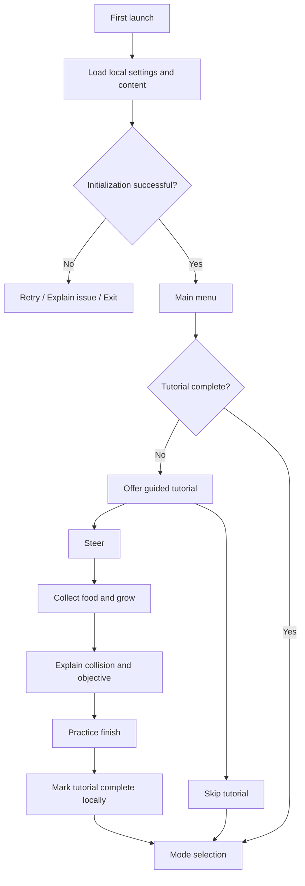
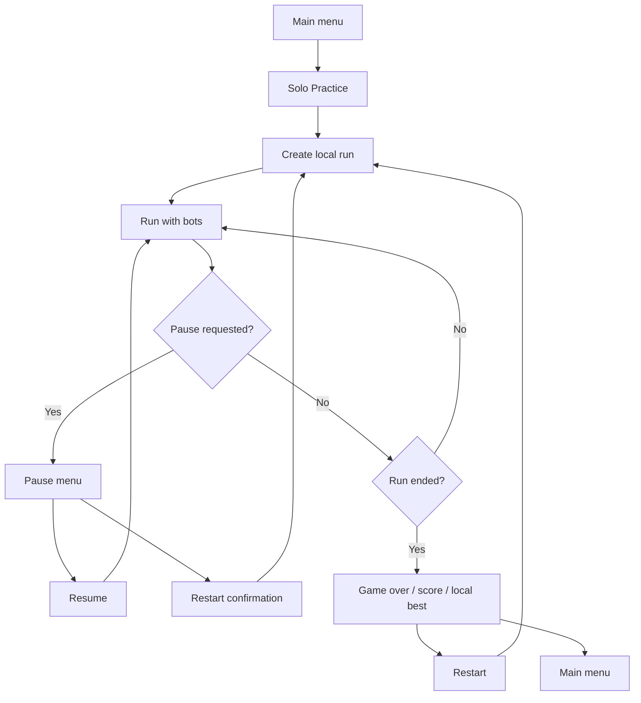
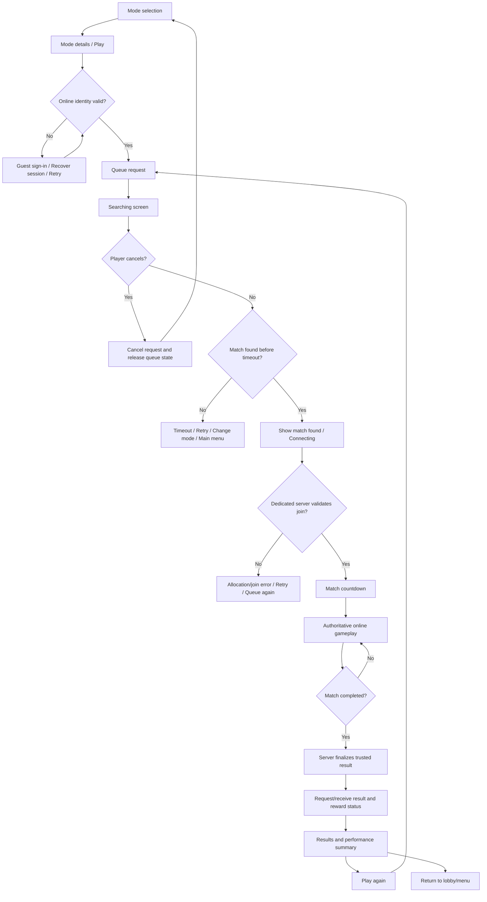
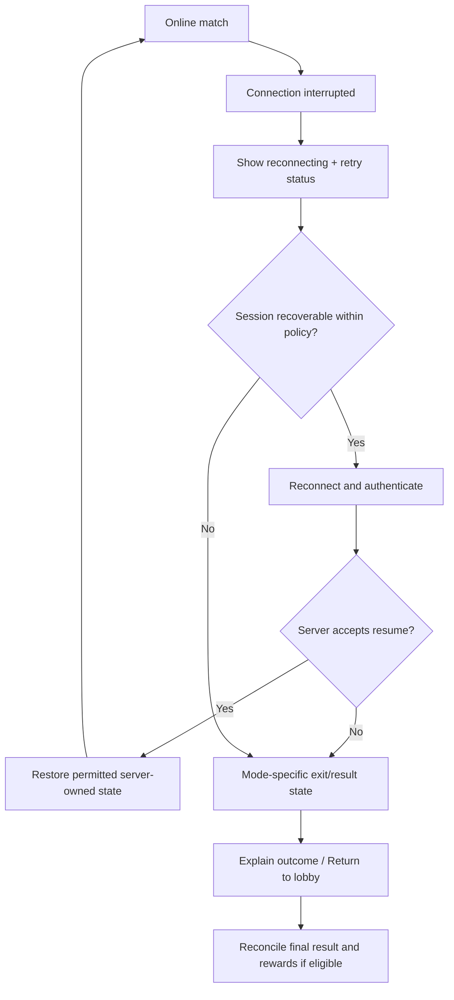
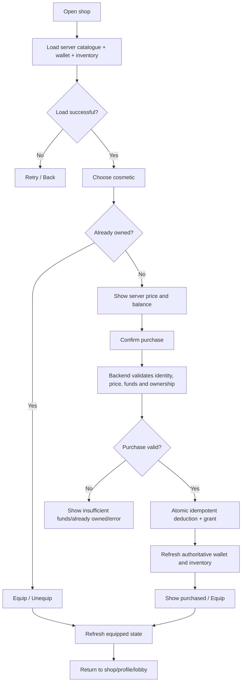
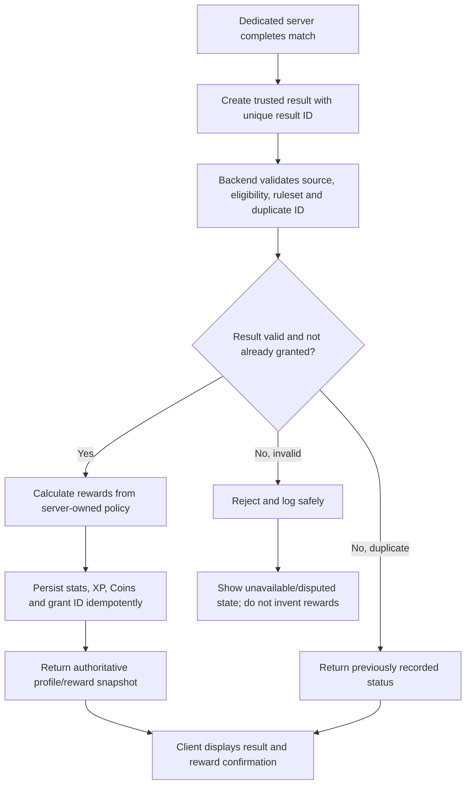
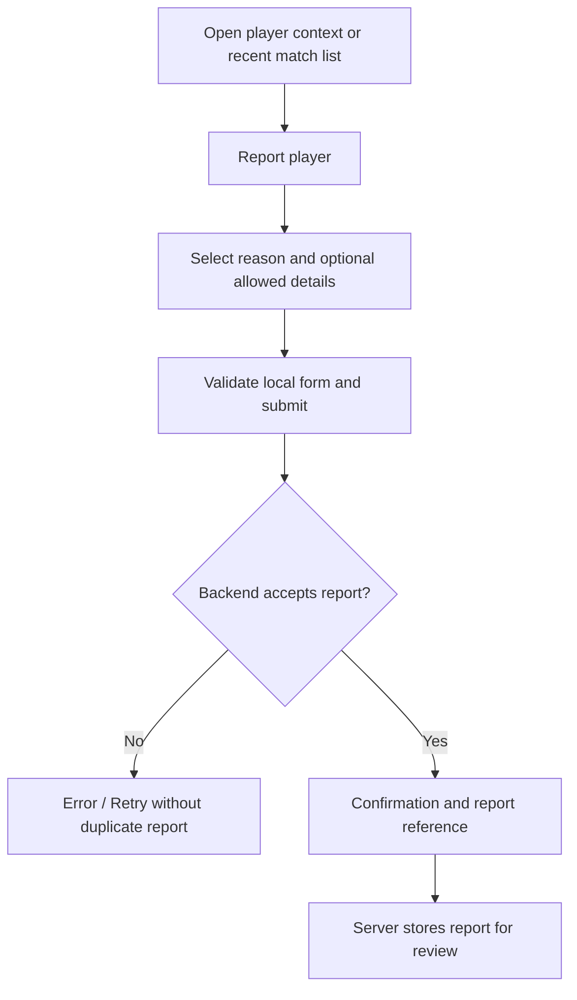

# IO User Journeys, Screen Flows & Failure Paths

**Status:** UX/system-flow specification — proposed flows, not implemented screens  
**Last reviewed:** 12 October 2026  
**Companion docs:** [FEATURE_INVENTORY.md](FEATURE_INVENTORY.md), [MULTIPLAYER_DESIGN.md](MULTIPLAYER_DESIGN.md), [ROADMAP.md](ROADMAP.md).

## 1. Flow principles

1. Keep offline Solo Practice available without requiring an account or internet connection.
2. Do not send a player into matchmaking without clearly showing the selected mode and an option to cancel.
3. Treat the client as a presentation/input layer; the match server owns live results and the backend owns persistent progression, wallet and inventory.
4. Every asynchronous screen needs loading, success, empty, retry, timeout and error states as applicable. Avoid endless spinners and dead ends.
5. Online settings overlays must not pause the shared match. Local input can be disabled while an overlay is open only if the match remains fair and the policy is clear.
6. No reward UI is proof of a reward grant; display trusted backend acknowledgement, handle delayed response and retry safely.
7. Use original art, names and screens. No copying protected game artwork/branding.
8. Keep all numeric mode rules and economy balance values aligned with [MULTIPLAYER_DESIGN.md](MULTIPLAYER_DESIGN.md).

## 2. Primary navigation map

The first launch does not require account creation for Solo Practice. Online identity/session validation is required before joining an authoritative online match; the exact guest/auth provider remains a Phase 3 decision.

## 3. First launch and tutorial

### Tutorial requirements
- Teach one action at a time with a visible objective and a skip/pause option.
- Cover steering, food collection/growth, collision/death, restart and the chosen mode objective.
- Teach boost only if the boost feature has been approved and implemented.
- Let players replay the tutorial from Help/Settings.
- Do not make tutorial completion a gate to all play modes; an optional short first-run hint may appear when returning to the menu.

## 4. Offline Solo Practice

Requirements:
- Pause really pauses only the local run; confirm restart if losing the current run is destructive.
- Preserve the local best score across app restarts.
- If the app is backgrounded, follow the offline lifecycle rule and test manual pause versus automatic pause separately.
- Make it explicit that local practice is offline/local and does not award trusted online Coins/XP in the initial design.
- Empty/error handling: if content fails to load or setup is invalid, show retry/return options rather than an unresponsive play screen.

## 5. Online matchmaking and match lifecycle

### Queue and join states that need explicit UI
- Idle, queue request pending, searching, cancelling, match found, connecting, server validating, countdown, in match, completed.
- Retryable errors: transient network issue, no match before timeout, allocation/server unavailable.
- Terminal/actionable errors: unsupported client build, account/session invalid, maintenance, explicit ban/suspension.
- A cancellation must reconcile the queue/session state so a late “match found” event cannot unexpectedly pull the user into a game.
- Never show “Match found” as connected until the server accepted the authenticated session.
- Do not allow a client-supplied score, placement or reward value to transition a player to a trusted reward state.

## 6. In-match UX

### Shared HUD
- Current mode and match timer.
- Server-sourced score and current placement; in TDM also team score/team identity.
- Core steering input and any approved boost control.
- Connection indicator when relevant, with readable low-connection/reconnecting states.
- Mode-specific objective: individual score/respawns for FFA, team score for TDM, safe-zone warning/phase and survival status for Survival Royale.
- Contextual event feedback such as food pickup, elimination, respawn and match-end announcement.
- Essential text/icons must stay clear of steering area and fit portrait phone/tablet safe areas.

### Online pause/settings overlay
- Offer settings/help/leave confirmation, but the server match clock continues.
- If local movement input is intentionally suppressed under the overlay, tell the user; do not present this as a globally paused match.
- A leave-match action must show whether leaving forfeits the match/result or remains eligible for completion rewards. Exact policy is a mode-design decision.
- The quit/leave flow must be safe under a connection loss or a delayed server response.

### Match-end presentation
- Only show final scores after receiving a server-authenticated result.
- Display mode, placement, score, duration and relevant stats (food, eliminations, team contributions or survival duration as applicable).
- Show XP/Coins as pending until backend acknowledgement. If grant processing is delayed, display a recoverable “processing/retry” state and reconcile using an idempotent result/transaction ID.
- Provide Play Again, Change Mode and Main Menu actions; ensure repeated taps do not create duplicate queues or grants.

## 7. Connection lost and reconnect flow

The exact grace period, player freeze/AI takeover policy and eligibility for rewards are unresolved. Decide them before launching public FFA. Requirements:
- Show connection state without blocking the whole playfield.
- Use bounded retries/backoff; avoid an infinite spinner.
- Never let the client restore arbitrary position, score, inventory or invulnerability after reconnect.
- FFA/TDM/Survival Royale may require different outcomes on disconnect. Define each explicitly.
- If the server has completed the match while the client was disconnected, recover the finalized result through a trusted lookup instead of trusting a local screen.

## 8. Shop, purchase and cosmetic equip flow

Security and reliability:
- The backend owns price, balance, purchase outcome and ownership.
- A client purchase request contains an item ID and idempotency key, not a trusted price or new balance.
- The operation must not deduct or grant twice on a timeout/retry. Return the recorded result for the same transaction key.
- If confirmation response is lost, refresh authoritative state before asking the player to purchase again.
- Reject equipping an item that the server says the player does not own.
- Cosmetics are visual only; no combat attribute or collision advantage.

## 9. Match-result and reward reconciliation

The backend grant must be idempotent, versioned and auditable. A mobile client must not submit its own “I won” payload as proof. The trusted link between dedicated match server and reward backend is a Phase 3 technology-spike exit requirement.

## 10. Profile, identity and account lifecycle

Recommended shape, pending identity provider approval:
- Offline practice is available without login.
- Online play requires a valid server-verifiable identity/session.
- A guest/anonymous identity may reduce signup friction, but account linking/recovery semantics must be understood before promising cross-device recovery.
- Profile loading shows a loading state, retry, and a safe limited/offline fallback if appropriate.
- Never show a false “saved” state before the backend confirms a profile update.
- Account deletion route (if accounts ship publicly): explain consequences, authenticate the request, submit deletion, show pending/completed state and state what happens to retained records where policy/law permits retention.
- Do not put authentication tokens, private keys or trusted wallet/progression in PlayerPrefs or logs.

## 11. Report and safety flow

Before public launch define report categories, rate limits, evidence minimization, review/appeal owner, suspension/ban enforcement and what acknowledgement can safely be shown. Do not promise a specific penalty or reveal confidential moderation actions. If communication/chat is ever added, block/mute and moderation requirements must be designed before enabling it.

## 12. Global error-state inventory

| Situation | Required user response | Must not happen |
|---|---|---|
| Local initialization/content failure | Error explanation, retry, exit/back | Endless spinner or dead menu |
| No internet on launch | Allow Solo Practice if its assets are local; explain online unavailable | Force login just to practise offline |
| Authentication/session expired | Re-authenticate/retry and preserve safe navigation | Trust stale client identity |
| Queue timeout/no match | Retry, cancel/change mode, return to menu | Leave invisible queue running |
| User cancels queue | Confirm cancellation and clear server queue state | Join a late match unexpectedly |
| Allocation/join rejected | Explain retryable versus terminal issue | Infinite connect loop |
| Client version mismatch | Update-required message / exit | Silent desynchronization |
| Match connection lost | Bounded reconnect and clear status | Restore arbitrary client state |
| Backend profile/shop unavailable | Retry/back and mark data stale | Pretend purchase/profile write succeeded |
| Purchase result ambiguous | Query transaction state then reconcile | Double-charge or prompt immediate duplicate purchase |
| Reward grant delayed | Show pending and reconcile via unique result ID | Display an unconfirmed reward as owned/spendable |
| Player reported | Confirmation without exposing moderator-only details | Promise punishment or reveal private action |
| App backgrounds mid-match | Apply explicit lifecycle/reconnect rule | Assume an offline pause freezes online server time |
| Server maintenance/overload | Actionable message, retry/back | Endless retry storm |

## 13. Exit criteria for this document

Before Phase 3 networking spike:
- Review the screen/navigation map, identity assumptions and match lifecycle.
- Resolve initial FFA disconnect/rejoin policy enough to test a vertical slice.
- Approve minimum online HUD and result screen information.
- Approve server-authority boundary and result/reward reconciliation flow.

Before public FFA:
- Every path from mode selection to rewards has been exercised, including cancellation, failure, timeout and disconnect.
- Required display-name/report/suspension and privacy/account requirements are implemented and tested for the chosen public-release scope.
- Backend wallet/profile state is never changed by an untrusted client.
- Device tests cover safe areas, backgrounding, poor network and repeated queue actions.

Before adding TDM or Survival Royale:
- Shared lifecycle and result flows are proven reusable.
- Each mode's unique HUD, respawn/disconnect/winner rules and edge cases are explicitly added to this file and [MULTIPLAYER_DESIGN.md](MULTIPLAYER_DESIGN.md).
